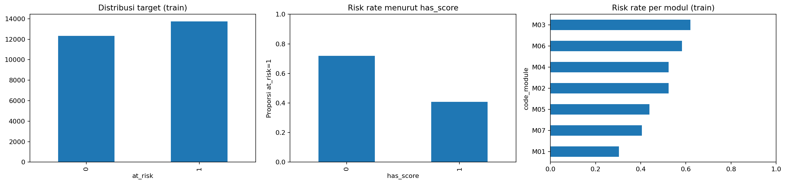
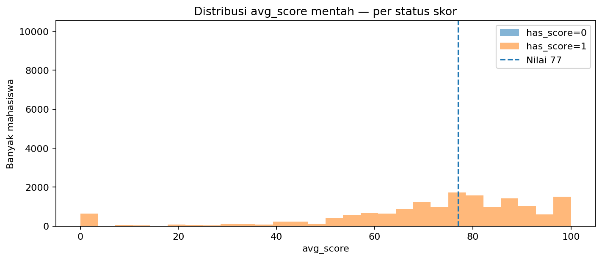
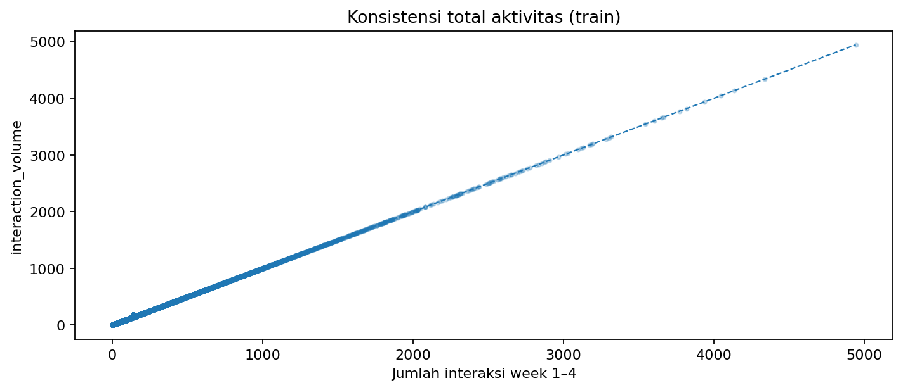
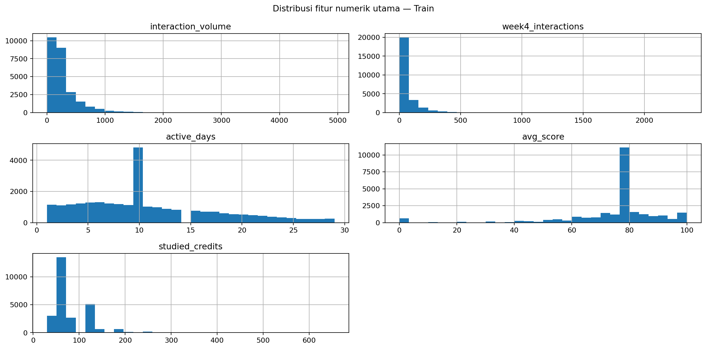
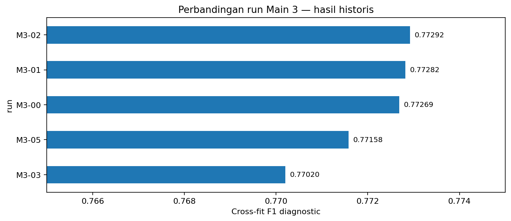
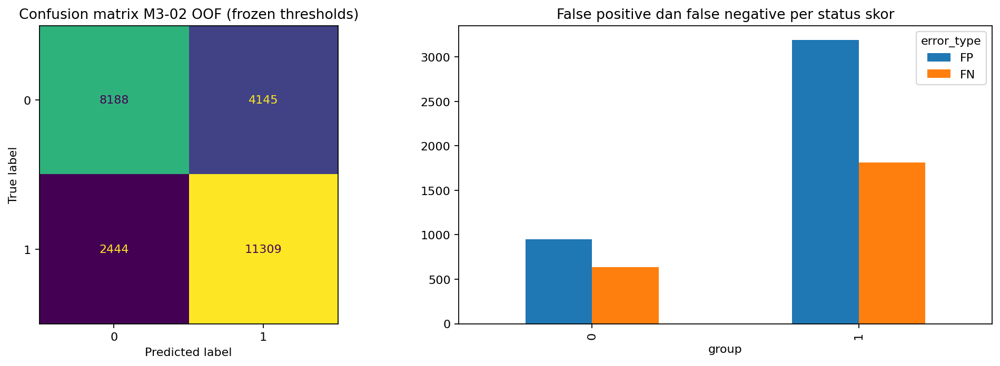

# DSCO 2026 — Main 3 Full Analysis

## Problem & evaluation

Predict student at_risk. Metric: binary F1. Data test tidak memiliki label.

## EDA Summary

dataset     n  features  score_0  score_1  target_rate
  train 26086        62    10046    16040     0.527218
   test  6502        62     2636     3866          NaN

### Risiko per status skor

 has_score     n  risk_count  risk_rate
         0 10046        7216   0.718296
         1 16040        6537   0.407544

### Pola nilai 77

dataset             column  has_score     n  n_unique  count_77  fraction_77
  train          avg_score          0 10046         1     10046     1.000000
  train          avg_score          1 16040       163       196     0.012219
  train       median_score          0 10046         1     10046     1.000000
  train       median_score          1 16040       163       196     0.012219
  train          min_score          0 10046         1     10046     1.000000
  train          min_score          1 16040        95       222     0.013840
  train          max_score          0 10046         1     10046     1.000000
  train          max_score          1 16040        94       215     0.013404
  train score_Assessment_2          0 10046         1     10046     1.000000
  train score_Assessment_2          1 16040        94      2910     0.181421
   test          avg_score          0  2636         1      2636     1.000000
   test          avg_score          1  3866       132        45     0.011640
   test       median_score          0  2636         1      2636     1.000000
   test       median_score          1  3866       132        45     0.011640
   test          min_score          0  2636         1      2636     1.000000
   test          min_score          1  3866        85        47     0.012157
   test          max_score          0  2636         1      2636     1.000000
   test          max_score          1  3866        84        50     0.012933
   test score_Assessment_2          0  2636         1      2636     1.000000
   test score_Assessment_2          1  3866        82       675     0.174599

### Aktivitas tidak konsisten

dataset     n  mismatch  percentage
  train 26086      3737   14.325692
   test  6502       947   14.564749

### Train-test shift

           column  train_unique  test_unique  unseen_test_categories  total_variation_distance
highest_education             5            5                       1                  0.439469
      code_module             7            8                       1                  0.063359
        has_score             2            2                       0                  0.020303
         imd_band            11           11                       0                  0.020117
code_presentation             4            4                       0                  0.007555

## Cleaning & feature engineering

Historical M2-06 normalization; mask scores when has_score=0; recompute inconsistent aggregates; 5 missingness interaction features in M3-02.

### Feature register

  run  n_features                                                                                                                                           added_vs_m3_00  masked_avg_score_rows
M3-00          88                                                                                                                                                   (none)                  10046
M3-01          95                           raw_avg_score, raw_max_score, raw_median_score, raw_min_score, raw_score_Assessment_2, raw_score_std, raw_weighted_score_total                  10046
M3-02          93 score_missing_x_active_days, score_missing_x_activity_inconsistent, score_missing_x_log_volume, score_missing_x_log_week4, score_missing_x_no_submission                  10046
M3-03          93 score_missing_x_active_days, score_missing_x_activity_inconsistent, score_missing_x_log_volume, score_missing_x_log_week4, score_missing_x_no_submission                  10046
M3-05          93 score_missing_x_active_days, score_missing_x_activity_inconsistent, score_missing_x_log_volume, score_missing_x_log_week4, score_missing_x_no_submission                  10046

## Experimental design & historical evidence

  run  features  roc_auc  f1_group_oof  crossfit_selected_f1
M3-02        93 0.845422      0.774403              0.772923
M3-01        95 0.845273      0.774107              0.772821
M3-00        88 0.845031      0.774029              0.772687
M3-05        95 0.845209      0.772817              0.771577
M3-03        93 0.842036      0.771559              0.770201

## Rerun results

  run  features  roc_auc  f1_global_oof  f1_group_oof  crossfit_global_f1  crossfit_group_f1 selected_decision  crossfit_selected_f1  precision   recall  threshold_global  threshold_group0  threshold_group1
M3-02        93 0.845422       0.773641      0.774403            0.772692           0.772923             group              0.772923   0.731785 0.822293             0.375              0.42              0.37

### Fold diagnostics

 fold    n       f1      auc  precision   recall   TP  FP  FN   TN
    1 5218 0.769991 0.841208   0.725112 0.820792 2258 856 493 1611
    2 5217 0.780546 0.854109   0.739980 0.825818 2271 798 479 1669
    3 5217 0.778553 0.847838   0.731840 0.831636 2287 838 463 1629
    4 5217 0.768675 0.839789   0.729977 0.811705 2233 826 518 1640
    5 5217 0.774238 0.844403   0.732102 0.821519 2260 827 491 1639

### Historical vs rerun

  run  historical_f1  rerun_f1     delta_f1  historical_auc  rerun_auc
M3-02       0.774403  0.774403 3.964461e-07        0.845422   0.845422

### Error analysis

group error_type     n
    0         FN   634
    0         FP   952
    0    correct  8460
    1         FN  1810
    1         FP  3193
    1    correct 11037

## Selected candidate

M3-02; fixed group thresholds 0.420 / 0.370. Rerun F1 OOF 0.774403, AUC 0.845422.

Historical public Kaggle F1 reported 0.78393; an additional 0.78000 score appeared on the final screenshot. These are external leaderboard results, not notebook-computed metrics.

## Limitations

The underlying feature generation timestamps and source mapping for GGG are not independently verified.

Thresholds selected on full OOF can be optimistic; threshold cross-fit diagnostic is not nested validation.

Model and feature engineering may be version-sensitive. A different rerun file may have a different Kaggle score.

## Figures

